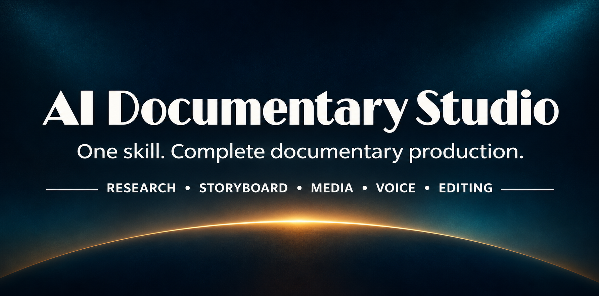
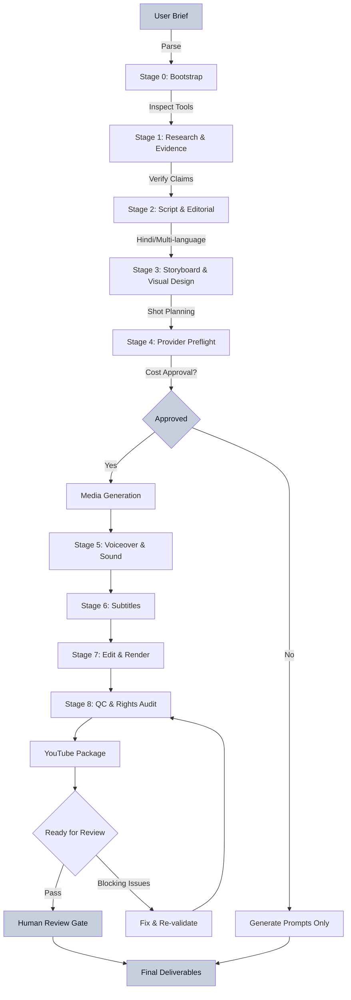

<div align="center">



<div style="background: #0D1117; padding: 20px 0;">

[](#master-skill)
[](#specialist-modules)
[](#claude-code-setup)
[](#opencode-setup)

</div>

<p style="color: #9BA8B7; font-size: 1.2em; margin: 20px 0;">
<b>One skill. One prompt. One coordinated documentary workflow.</b>
</p>

[About](#about) • [Capabilities](#what-this-studio-can-do) • [Modules](#specialist-modules) • [Workflow](#production-workflow) • [Installation](#installation) • [Configuration](#configuration) • [Documentation](#documentation)

</div>

---

## About

**AI Documentary Studio** is a single advanced agent skill for Claude Code and OpenCode that orchestrates complete documentary production from a single invocation. Invoke `ai-documentary-studio` once; it coordinates research, fact-checking, scriptwriting, storyboarding, visual prompts, media generation, Hindi voiceover, sound design, subtitles, editing, rendering, quality control, rights tracking, and YouTube packaging through internal specialist playbooks.

<table style="width: 100%; background: #0D1117; border: 1px solid #C5D0DC;">
<tr>
<td style="color: #FFFFFF; padding: 15px; border-bottom: 1px solid #C5D0DC;"><b>⚠️ Important</b></td>
</tr>
<tr>
<td style="color: #9BA8B7; padding: 15px;">
This repository contains instructions, workflows, templates, and helper scripts. It does <b>not</b> include AI models, paid API credits, image/video generation services, TTS subscriptions, or an editing application. Actual media generation and final rendering depend on tools and providers configured in your environment.
</td>
</tr>
</table>

---

## Project Statistics

<div align="center">

| Component | Count | Location |
|-----------|-------|----------|
| **Master Skill** | 1 | [`.claude/skills/ai-documentary-studio/SKILL.md`](.claude/skills/ai-documentary-studio/SKILL.md) |
| **Internal Specialist Modules** | 18 | [`.claude/skills/ai-documentary-studio/references/`](.claude/skills/ai-documentary-studio/references/) |
| **Project Templates** | 10 | [`.claude/skills/ai-documentary-studio/templates/`](.claude/skills/ai-documentary-studio/templates/) |
| **Helper Scripts** | 2 | [`.claude/skills/ai-documentary-studio/scripts/`](.claude/skills/ai-documentary-studio/scripts/) |
| **Production Stages** | 9 | Research → Script → Media → Render → QC → Package |

</div>

---

## What This Studio Can Do

<table style="width: 100%; background: #0D1117;">
<tr>
<td width="50%" style="padding: 20px; vertical-align: top; border-right: 1px solid #C5D0DC;">

### 🎬 Full Production Pipeline
- Research with fact verification
- Multi-language scriptwriting (Hindi default)
- Cinematic storyboarding
- AI media generation coordination
- Professional voiceover orchestration
- Sound design and music cues
- Subtitle generation with QC

</td>
<td width="50%" style="padding: 20px; vertical-align: top;">

### 🔍 Quality & Compliance
- Evidence-based claim tracking
- Copyright and licensing audit
- Technical quality validation
- Rights and consent documentation
- YouTube packaging standards
- Human review gates
- Cost approval workflow

</td>
</tr>
</table>

---

## Specialist Modules

**One discoverable skill:** Users select **only** `ai-documentary-studio`. The 18 specialist modules below are **internal references** loaded by the master skill as needed—not 18 separately selectable skills.

### 📋 Pre-Production (3 modules)
<table style="width: 100%; background: #0D1117; border: 1px solid #C5D0DC;">
<tr style="background: #0D1117;">
<td style="padding: 12px; color: #C5D0DC; border-bottom: 1px solid #C5D0DC;"><b>00-production-control.md</b></td>
<td style="padding: 12px; color: #9BA8B7; border-bottom: 1px solid #C5D0DC;">Orchestration, cost gates, provider inspection, status tracking</td>
</tr>
<tr>
<td style="padding: 12px; color: #C5D0DC; border-bottom: 1px solid #C5D0DC;"><b>01-research.md</b></td>
<td style="padding: 12px; color: #9BA8B7; border-bottom: 1px solid #C5D0DC;">Source discovery, citation tracking, timeline construction</td>
</tr>
<tr>
<td style="padding: 12px; color: #C5D0DC;"><b>02-fact-checking.md</b></td>
<td style="padding: 12px; color: #9BA8B7;">Claim verification, evidence grading, uncertainty handling</td>
</tr>
</table>

### ✍️ Content Creation (3 modules)
<table style="width: 100%; background: #0D1117; border: 1px solid #C5D0DC;">
<tr>
<td style="padding: 12px; color: #C5D0DC; border-bottom: 1px solid #C5D0DC;"><b>03-scriptwriting.md</b></td>
<td style="padding: 12px; color: #9BA8B7; border-bottom: 1px solid #C5D0DC;">Hindi/multi-language narration, story structure, duration timing</td>
</tr>
<tr>
<td style="padding: 12px; color: #C5D0DC; border-bottom: 1px solid #C5D0DC;"><b>04-storyboard.md</b></td>
<td style="padding: 12px; color: #9BA8B7; border-bottom: 1px solid #C5D0DC;">Visual scene breakdown, shot planning, beat mapping</td>
</tr>
<tr>
<td style="padding: 12px; color: #C5D0DC;"><b>06-continuity.md</b></td>
<td style="padding: 12px; color: #9BA8B7;">Visual consistency, character/setting tracking, style bible</td>
</tr>
</table>

### 🎨 Visual Production (2 modules)
<table style="width: 100%; background: #0D1117; border: 1px solid #C5D0DC;">
<tr>
<td style="padding: 12px; color: #C5D0DC; border-bottom: 1px solid #C5D0DC;"><b>05-visual-prompting.md</b></td>
<td style="padding: 12px; color: #9BA8B7; border-bottom: 1px solid #C5D0DC;">Cinematic prompt engineering for image/video generation</td>
</tr>
<tr>
<td style="padding: 12px; color: #C5D0DC;"><b>07-media-generation.md</b></td>
<td style="padding: 12px; color: #9BA8B7;">Provider routing, batch management, quality inspection</td>
</tr>
</table>

### 🎙️ Audio Production (3 modules)
<table style="width: 100%; background: #0D1117; border: 1px solid #C5D0DC;">
<tr>
<td style="padding: 12px; color: #C5D0DC; border-bottom: 1px solid #C5D0DC;"><b>08-voiceover.md</b></td>
<td style="padding: 12px; color: #9BA8B7; border-bottom: 1px solid #C5D0DC;">Narration recording, pronunciation, pacing, segmentation</td>
</tr>
<tr>
<td style="padding: 12px; color: #C5D0DC; border-bottom: 1px solid #C5D0DC;"><b>09-audio-design.md</b></td>
<td style="padding: 12px; color: #9BA8B7; border-bottom: 1px solid #C5D0DC;">Music selection, sound effects, audio cue sheets</td>
</tr>
<tr>
<td style="padding: 12px; color: #C5D0DC;"><b>17-voice-generation.md</b></td>
<td style="padding: 12px; color: #9BA8B7;">TTS provider integration, voice consistency, consent tracking</td>
</tr>
</table>

### 📝 Post-Production Text (1 module)
<table style="width: 100%; background: #0D1117; border: 1px solid #C5D0DC;">
<tr>
<td style="padding: 12px; color: #C5D0DC;"><b>10-subtitles.md</b></td>
<td style="padding: 12px; color: #9BA8B7;">Subtitle generation, Devanagari handling, timing validation</td>
</tr>
</table>

### 🎞️ Editing & Rendering (2 modules)
<table style="width: 100%; background: #0D1117; border: 1px solid #C5D0DC;">
<tr>
<td style="padding: 12px; color: #C5D0DC; border-bottom: 1px solid #C5D0DC;"><b>11-editing.md</b></td>
<td style="padding: 12px; color: #9BA8B7; border-bottom: 1px solid #C5D0DC;">Edit decision lists, timeline assembly, non-destructive workflow</td>
</tr>
<tr>
<td style="padding: 12px; color: #C5D0DC;"><b>12-rendering.md</b></td>
<td style="padding: 12px; color: #9BA8B7;">Export profiles, codec selection, FFmpeg integration</td>
</tr>
</table>

### ✅ Quality & Rights (2 modules)
<table style="width: 100%; background: #0D1117; border: 1px solid #C5D0DC;">
<tr>
<td style="padding: 12px; color: #C5D0DC; border-bottom: 1px solid #C5D0DC;"><b>13-quality-control.md</b></td>
<td style="padding: 12px; color: #9BA8B7; border-bottom: 1px solid #C5D0DC;">Technical validation, A/V sync, black frame detection, metadata verification</td>
</tr>
<tr>
<td style="padding: 12px; color: #C5D0DC;"><b>14-rights-audit.md</b></td>
<td style="padding: 12px; color: #9BA8B7;">License tracking, attribution, consent documentation, rights clearance</td>
</tr>
</table>

### 📦 Publishing (2 modules)
<table style="width: 100%; background: #0D1117; border: 1px solid #C5D0DC;">
<tr>
<td style="padding: 12px; color: #C5D0DC; border-bottom: 1px solid #C5D0DC;"><b>15-youtube-package.md</b></td>
<td style="padding: 12px; color: #9BA8B7; border-bottom: 1px solid #C5D0DC;">Title, description, chapters, thumbnail briefs, upload checklist</td>
</tr>
<tr>
<td style="padding: 12px; color: #C5D0DC;"><b>16-provider-routing.md</b></td>
<td style="padding: 12px; color: #9BA8B7;">API capability inspection, model selection, cost estimation</td>
</tr>
</table>

---

## Production Workflow



---

## How the Master Skill Works

### Operating Contract

1. **One entry point**: User invokes `/ai-documentary-studio` or `@ai-documentary-studio` once
2. **Actually execute**: Generate assets, create audio, render video—not just plans
3. **Capability-honest**: Inspect tools/providers before promising outputs
4. **Cost gates**: Obtain approval before paid generation/uploads
5. **No credential exposure**: Read secrets from environment only
6. **Evidence first**: Every claim maps to verified sources
7. **Rights tracking**: Record provenance for every asset
8. **Human review**: Prepare review package before publishing
9. **Protect workspace**: Files go to `documentary-projects/<slug>/`
10. **Report truthfully**: Distinguish completed, blocked, needs-approval states

### Stage Execution

The master skill loads internal modules **only when needed** for the current stage:

- **Stage 0**: Inspect repo, tools, providers → bootstrap project folder
- **Stage 1**: Research → create `sources.csv`, `claim_register.csv`, `timeline.md`
- **Stage 2**: Script → write Hindi/requested-language narration with fact mapping
- **Stage 3**: Storyboard → plan shots, visual coverage, continuity bible
- **Stage 4**: Media generation → provider preflight, cost approval, batch generation
- **Stage 5**: Audio → voiceover, music, SFX with license tracking
- **Stage 6**: Subtitles → generate, validate timing, QC
- **Stage 7**: Render → assemble, export final MP4 (when tools available)
- **Stage 8**: QC → technical validation, rights audit, YouTube package

**Key principle**: Free/reversible stages (research, script, storyboard) proceed automatically. Paid generation, uploads, publishing require explicit approval.

---

## Installation

### Project-Local (Recommended)

Copy the complete `.claude/skills/ai-documentary-studio/` folder into your target project:

```bash
<your-project>/.claude/skills/ai-documentary-studio/
```

Keep `SKILL.md`, `references/`, `scripts/`, `templates/`, and `assets/` together in the same directory.

### Global Installation (Windows)

From repository root in PowerShell:

```powershell
powershell -ExecutionPolicy Bypass -File .\install-global-windows.ps1
```

**Replace existing installation** (use with caution):

```powershell
powershell -ExecutionPolicy Bypass -File .\install-global-windows.ps1 -Force
```

Installs to: `~/.claude/skills/ai-documentary-studio/`

### Global Installation (macOS / Linux)

```bash
bash ./install-global-unix.sh
```

**Replace existing installation**:

```bash
bash ./install-global-unix.sh --force
```

Installs to: `~/.claude/skills/ai-documentary-studio/`

---

## Configuration

### Claude Code Setup

1. Install skill (project-local or global)
2. Claude Code auto-discovers from:
   - Project: `.claude/skills/<name>/SKILL.md`
   - Personal: `~/.claude/skills/<name>/SKILL.md`
3. Invoke with:

```text
/ai-documentary-studio
Create an 8-10 minute Hindi documentary about [topic].
Use cinematic 2D/3D visuals, 16:9, 1080p.
Research, script, generate media, narrate, edit, render, and QC.
```

### OpenCode Setup

1. Install skill (same paths as Claude Code)
2. OpenCode discovers Claude-compatible skill structure
3. Invoke with:

```text
@ai-documentary-studio
Create an 8-10 minute Hindi documentary about [topic].
Use cinematic 2D/3D visuals, 16:9, 1080p.
Research, script, generate media, narrate, edit, render, and QC.
```

---

## Media Provider and API Configuration

### Image/Video Generation

The skill inspects **actually configured** providers. Configure before use:

- **Image**: DALL-E, Midjourney, Stable Diffusion, Flux
- **Video**: Runway, Pika, Kling, Luma Dream Machine
- Verify model IDs, limits, aspect ratios, licensing, cost

**Provider discovery**:
- Skill reads `.env`, provider config files, or API documentation in workspace
- Never paste API keys in chat
- Use environment variables: `OPENAI_API_KEY`, `RUNWAY_API_TOKEN`, etc.

### Text-to-Speech (Voiceover)

- **Hindi TTS**: ElevenLabs, Azure TTS, Google Cloud TTS
- Default: Natural neutral Hindi narrator (not celebrity voice)
- Voice consistency tracked in `voiceover_manifest.csv`

### Audio Assets (Music/SFX)

- **Royalty-free sources**: Pixabay, Epidemic Sound, Artlist
- License terms tracked in `audio_asset_licenses.csv`
- Attribution requirements enforced

**Important**: Skill generates **prompts and orchestration logic** even when providers unavailable. Actual image/video/audio generation requires:
1. Valid API credentials in environment
2. Sufficient quota/budget
3. Explicit cost approval for paid requests

---

## Video Rendering Requirements

### FFmpeg (Required for Rendering)

Install FFmpeg and add to system PATH:

- **Windows**: [ffmpeg.org/download.html](https://ffmpeg.org/download.html)
- **macOS**: `brew install ffmpeg`
- **Linux**: `sudo apt install ffmpeg` or `sudo yum install ffmpeg`

Verify installation:

```bash
ffmpeg -version
ffprobe -version
```

### Rendering Workflow

1. Skill assembles edit decision list
2. Checks for FFmpeg availability
3. Constructs render command with:
   - Video codec: H.264 (libx264)
   - Audio codec: AAC
   - Resolution: 1920×1080 (default)
   - Frame rate: 25/30 fps
   - Subtitles: burned-in or soft (SRT)
4. Executes render → `08_exports/final.mp4`
5. Validates output with `ffprobe`

**Without FFmpeg**: Skill creates complete edit files and render profile but cannot produce final MP4. Manual render required in external editor.

---

## Output Structure and Deliverables

Default workspace: `documentary-projects/<project-slug>/`

```text
00_brief/
  └─ project_brief.yaml                 # Duration, language, visual style, assumptions

01_research/
  ├─ research_notes.md                  # Structured research findings
  ├─ sources.csv                        # URL, author, date, claim supported
  ├─ claim_register.csv                 # Claim ID, text, status, source IDs
  ├─ timeline.md                        # Event chronology
  └─ open_questions.md                  # Unresolved research items

02_script/
  ├─ master_script.md                   # Hindi/multi-language narration
  ├─ pronunciation_guide.md             # Technical terms, names
  ├─ chapter_outline.md                 # Story arc breakdown
  └─ script_fact_map.csv                # Narration paragraph → claim IDs

03_storyboard/
  ├─ storyboard.csv                     # Shot ID, duration, narration ID, visual description
  ├─ shot_list.md                       # Detailed shot planning
  ├─ visual_coverage_report.md          # Coverage analysis
  └─ continuity_bible.md                # Style, palette, character consistency

04_media/
  ├─ images/                            # Generated/sourced images
  ├─ videos/                            # Generated/sourced video clips
  ├─ diagrams/                          # Custom graphics, maps
  ├─ media_manifest.csv                 # Provider, model, prompt, path, cost
  ├─ image_prompts.md                   # All image generation prompts
  └─ video_prompts.md                   # All video generation prompts

05_audio/
  ├─ voiceover/                         # Narration segments
  ├─ music_sfx/                         # Background audio
  ├─ voiceover_manifest.csv             # Voice, duration, language accuracy
  ├─ audio_cue_sheet.csv                # Timing, purpose, asset path
  └─ audio_asset_licenses.csv           # Creator, URL, license, attribution

06_subtitles/
  ├─ hindi_subtitles.srt                # Devanagari subtitles (or requested language)
  ├─ subtitle_qc.md                     # Timing validation, corrections
  └─ subtitle_corrections.csv           # Error log

07_edit/
  ├─ edit_decision_list.md              # Non-destructive edit timeline
  ├─ render_profile.yaml                # Codec, resolution, frame rate
  └─ project_files/                     # DaVinci/Premiere/FFmpeg project files

08_exports/
  ├─ final.mp4                          # Rendered documentary (when available)
  └─ thumbnail/                         # YouTube thumbnail assets

09_reports/
  ├─ production_status.md               # Stage completion, blockers, next steps
  ├─ qc_report.md                       # Technical validation results
  ├─ asset_rights_register.csv          # License, attribution, consent tracking
  ├─ blocking_issues.md                 # Unresolved problems requiring human review
  └─ delivery_manifest.md               # Final deliverables checklist

10_youtube/
  ├─ title_options.md                   # 3-5 title variations
  ├─ description.md                     # SEO-optimized description with sources
  ├─ chapters.txt                       # Timestamped chapter markers
  ├─ thumbnail_brief.md                 # Visual design specification
  └─ upload_checklist.md                # Pre-publish verification
```

### Deliverables Checklist

✅ **Always Generated** (free, reversible):
- Research notes, sources, claim register
- Hindi/multi-language script with fact mapping
- Storyboard and shot planning
- Visual/audio prompts
- Edit decision list

⚠️ **Requires Providers** (cost approval needed):
- Generated images/videos in `04_media/`
- TTS voiceover in `05_audio/voiceover/`
- Final rendered MP4 in `08_exports/final.mp4`

🔒 **Requires Human Approval**:
- Paid API requests
- Public uploads
- YouTube publishing

---

## Quality Control and Copyright Checks

### Technical QC (Automated)

When FFmpeg available, skill validates:
- Video metadata (resolution, codec, frame rate, duration)
- Audio sync and levels
- Black frames or silent gaps
- Subtitle timing and encoding
- File integrity

**Validation script**:

```bash
python .claude/skills/ai-documentary-studio/scripts/validate_project.py documentary-projects/<project-slug>
```

Checks:
- File structure completeness
- CSV/SRT syntax
- Cross-references between manifests
- Required fields present

**Does NOT validate**:
- Factual accuracy (human editorial review required)
- Media quality/aesthetics
- Copyright clearance depth
- Render success (only structure)

### Rights and Copyright Audit

Tracked in `09_reports/asset_rights_register.csv`:
- **Source**: URL, creator, institution
- **License**: CC-BY, Public Domain, Royalty-Free, Fair Use claim
- **Attribution**: Required text
- **Consent**: Voice clone authorization, likeness rights
- **Usage Terms**: Commercial restrictions, modification limits

**Red flags for human review**:
- Paywalled content used without license
- Real person's likeness/voice without consent
- AI reconstruction presented as archival footage
- Watermark removal
- Unclear copyright status

---

## Troubleshooting and FAQ

### Skill Not Discovered

**Problem**: `/ai-documentary-studio` not found

**Solution**:
- Verify `SKILL.md` exists at `.claude/skills/ai-documentary-studio/SKILL.md` (project) or `~/.claude/skills/ai-documentary-studio/SKILL.md` (global)
- Check `references/`, `scripts/`, `templates/`, `assets/` folders present alongside `SKILL.md`
- Restart Claude Code/OpenCode after installation

### No Video Generated

**Problem**: Script/storyboard created but no MP4

**Likely causes**:
1. **Provider not configured**: Check `.env` for API keys
2. **Cost approval needed**: Skill waits at approval gate for paid generation
3. **FFmpeg missing**: Install FFmpeg for rendering
4. **Assets not generated**: If prompts created but no images/videos, provider API failed

**Verify**:
```bash
# Check FFmpeg
ffmpeg -version

# Check provider config
ls .env
cat .env | grep -i "API_KEY"  # Don't commit this output

# Check media manifest
cat documentary-projects/<slug>/04_media/media_manifest.csv
```

### Hindi Script in Wrong Script

**Problem**: Hindi narration in Latin script or incorrect encoding

**Solution**:
- Skill defaults to Devanagari for Hindi
- Check `02_script/master_script.md` encoding (UTF-8 required)
- Verify TTS provider supports Devanagari input
- Pronunciation guide in `02_script/pronunciation_guide.md` handles technical terms

### Subtitle Timing Off

**Problem**: Subtitles desync from audio

**Solution**:
1. Run validator: `python .claude/skills/ai-documentary-studio/scripts/validate_project.py <project-path>`
2. Check `06_subtitles/subtitle_qc.md` for timing warnings
3. Verify actual voiceover duration matches script estimates
4. Re-generate subtitles from **final audio** (not script)

### Cost Exploded

**Problem**: Unexpected API charges

**Prevention**:
- Skill requests approval **before** paid generation
- Review `04_media/media_manifest.csv` for provider/model/count
- Set budget cap in project brief
- Generate sample shots before full batch

**If already occurred**:
- Check `09_reports/production_status.md` for usage log
- Review provider dashboard for actual charges
- Adjust project brief budget constraints for next run

### Rights Clearance Unclear

**Problem**: Uncertain if asset usage is legal

**Solution**:
- Review `09_reports/asset_rights_register.csv`
- Check `09_reports/blocking_issues.md` for flagged items
- **Never assume Fair Use without legal review**
- Replace unclear assets with licensed alternatives
- Consult legal counsel for commercial use

---

## Documentation and Resources

### Repository Documentation

- **[Master Skill SKILL.md](.claude/skills/ai-documentary-studio/SKILL.md)** — Complete operating contract
- **[Specialist References](.claude/skills/ai-documentary-studio/references/INDEX.md)** — All 18 internal modules indexed
- **[Templates](.claude/skills/ai-documentary-studio/templates/)** — Project scaffolding files
- **[Scripts](.claude/skills/ai-documentary-studio/scripts/)** — `new_project.py`, `validate_project.py`
- **[AGENTS.md](AGENTS.md)** — Repository instructions for Claude agents
- **[CONSOLIDATION_MAP.md](CONSOLIDATION_MAP.md)** — Specialist module consolidation history
- **[README_BN.md](README_BN.md)** — Bengali guide

### Helper Scripts

**Create new project**:
```bash
python .claude/skills/ai-documentary-studio/scripts/new_project.py \
  --title "Your Documentary Title" \
  --duration "8-10 minutes" \
  --language "Hindi (Devanagari)"
```

**Validate project structure**:
```bash
python .claude/skills/ai-documentary-studio/scripts/validate_project.py documentary-projects/<project-slug>
```

### External Resources

- **Claude Code**: [claude.ai/code](https://claude.ai/code)
- **OpenCode**: [github.com/context-labs/opencode](https://github.com/context-labs/opencode)
- **FFmpeg**: [ffmpeg.org](https://ffmpeg.org)
- **Devanagari Unicode**: [unicode.org/charts/PDF/U0900.pdf](https://unicode.org/charts/PDF/U0900.pdf)

---

## Safety and Ethics

<table style="width: 100%; background: #0D1117; border: 1px solid #C5D0DC;">
<tr>
<td style="color: #C5D0DC; padding: 15px; border-bottom: 1px solid #C5D0DC;"><b>🔒 Credential Security</b></td>
<td style="color: #9BA8B7; padding: 15px; border-bottom: 1px solid #C5D0DC;">Never paste API keys in chat. Use environment variables. Never commit <code>.env</code>.</td>
</tr>
<tr>
<td style="color: #C5D0DC; padding: 15px; border-bottom: 1px solid #C5D0DC;"><b>💰 Cost Control</b></td>
<td style="color: #9BA8B7; padding: 15px; border-bottom: 1px solid #C5D0DC;">Explicit approval required before paid generation. Budget caps enforced.</td>
</tr>
<tr>
<td style="color: #C5D0DC; padding: 15px; border-bottom: 1px solid #C5D0DC;"><b>📜 Rights Tracking</b></td>
<td style="color: #9BA8B7; padding: 15px; border-bottom: 1px solid #C5D0DC;">Every asset's license, attribution, consent documented. Fair Use claims flagged for review.</td>
</tr>
<tr>
<td style="color: #C5D0DC; padding: 15px; border-bottom: 1px solid #C5D0DC;"><b>🎭 Ethical AI Use</b></td>
<td style="color: #9BA8B7; padding: 15px; border-bottom: 1px solid #C5D0DC;">AI reconstructions labeled. No fabricated citations. No unauthorized voice cloning.</td>
</tr>
<tr>
<td style="color: #C5D0DC; padding: 15px;"><b>👤 Human Review</b></td>
<td style="color: #9BA8B7; padding: 15px;">Editorial truth, legal clearance, publishing decisions require human sign-off.</td>
</tr>
</table>

---

## License

No license is currently declared. **Do not assume redistribution or reuse rights** until a license is selected and added by the repository owner.

---

<div align="center">

<p style="color: #9BA8B7; margin-top: 40px;">
Built for <b>Claude Code</b> and <b>OpenCode</b><br>
One skill. Complete documentary production.
</p>

**[⬆ Back to Top](#)**

</div>
