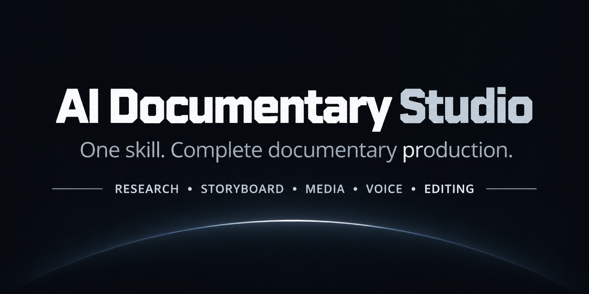

<p align="center">
  
</p>

# AI Documentary Studio

**One skill. One prompt. One coordinated documentary workflow.**

A single advanced, reusable agent skill for Claude Code and OpenCode. Invoke `ai-documentary-studio` once; it coordinates research, fact-checking, scriptwriting, storyboarding, visual prompts, media generation, Hindi voiceover, sound design, subtitles, editing, rendering, quality control, rights tracking, and YouTube packaging through internal specialist playbooks.

> This repository contains instructions, workflows, templates, and helper scripts. It does **not** include AI models, paid API credits, image/video generation services, TTS subscriptions, or an editing application. Actual media generation and final rendering depend on tools and providers configured in your environment.

## What's inside

- **1 discoverable master skill:** `.claude/skills/ai-documentary-studio/SKILL.md`
- **18 internal specialist reference modules:** loaded only when the workflow needs them; they are not separate skills to select.
- **Project templates:** research sources, claim register, script, storyboard, media manifest, voiceover, audio cues, rights, QC, and delivery.
- **Helper scripts:** scaffold a project and validate its manifests/SRT.
- **Claude Code + OpenCode:** shared `.claude/skills/` discovery layout.

## Invoke the studio

### Claude Code

```text
/ai-documentary-studio
Create an 8–10 minute Hindi documentary about India's Hidden AI Empire.
Use cinematic 2D/3D documentary visuals, 16:9, 1080p.
Research, write, generate media, narrate, edit, render, and quality-check the complete video.
```

### OpenCode

```text
@ai-documentary-studio
Create an 8–10 minute Hindi documentary about India's Hidden AI Empire.
Use cinematic 2D/3D documentary visuals, 16:9, 1080p.
Research, write, generate media, narrate, edit, render, and quality-check the complete video.
```

The agent should load the one master skill and consult its bundled references as needed. No separate specialist skill invocation is required.

## Install

### Project-local (recommended for a repository)

Copy the complete `.claude/skills/ai-documentary-studio/` folder into the root of your target project at:

```text
<your-project>/.claude/skills/ai-documentary-studio/
```

Keep `SKILL.md`, `references/`, `scripts/`, `templates/`, and `assets/` together.

### Global on Windows

From the repository root in PowerShell:

```powershell
powershell -ExecutionPolicy Bypass -File .\install-global-windows.ps1
```

If the skill is already installed, the installer stops rather than overwriting it. Review the existing folder first; use `-Force` only when you intentionally want to replace it:

```powershell
powershell -ExecutionPolicy Bypass -File .\install-global-windows.ps1 -Force
```

### Global on macOS / Linux

```bash
bash ./install-global-unix.sh
```

To intentionally replace an existing global installation:

```bash
bash ./install-global-unix.sh --force
```

Claude Code discovers project skills from `.claude/skills/<name>/SKILL.md` and personal skills from `~/.claude/skills/<name>/SKILL.md`. OpenCode also discovers the Claude-compatible project and global skill paths. The skill's supporting files must remain beside `SKILL.md`.

## Project output

By default, a documentary workspace is created under `documentary-projects/<project-slug>/`, with separate folders for brief, research, script, storyboard, media, audio, subtitles, editing, exports, reports, and YouTube packaging. Change the output location in the prompt when needed.

## Helper scripts

Create a project folder from templates:

```bash
python .claude/skills/ai-documentary-studio/scripts/new_project.py \
  --title "India's Hidden AI Empire" \
  --duration "8-10 minutes" \
  --language "Hindi (Devanagari)"
```

Validate the project manifests and SRT structure:

```bash
python .claude/skills/ai-documentary-studio/scripts/validate_project.py documentary-projects/indias-hidden-ai-empire
```

The validator checks file/CSV/SRT structure and references. It does not verify factual truth, media quality, copyright clearance, or the success of a render.

## Safety, cost, and publishing gates

- Never paste API keys into chat or commit secrets. Use local environment variables/secret stores.
- A request to make a video is not blanket approval for unknown paid API use. The skill must obtain approval for paid generation and stay within the stated cap.
- Verify each provider's current model, limits, price, and license before use.
- Never represent AI reconstructions as archival footage or fabricate citations/claims.
- Track licenses, attribution, voice consent, and asset provenance.
- The skill prepares a YouTube publishing pack; it does not upload or publish without explicit approval.
- A final MP4 is considered complete only when the file exists and its metadata/playback have been checked.

## Contents

- [Master Skill](.claude/skills/ai-documentary-studio/SKILL.md)
- [Specialist references](.claude/skills/ai-documentary-studio/references/)
- [Templates](.claude/skills/ai-documentary-studio/templates/)
- [Scripts](.claude/skills/ai-documentary-studio/scripts/)
- [Bengali guide](README_BN.md)
- [Agent instructions](AGENTS.md)
- [Specialist consolidation map](CONSOLIDATION_MAP.md)

## License

No license is declared. Do not assume redistribution or reuse rights until a license is selected and added by the repository owner.
